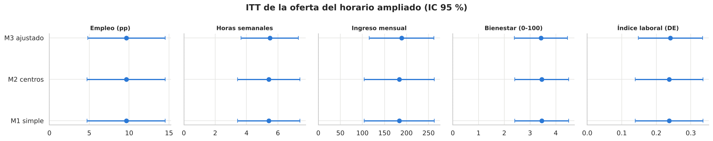

```{=html}
<div class="hero">
  <div class="kicker">Evaluación de impacto · Experimento aleatorizado</div>
  <h1>Ofrecer horario ampliado de cuidado infantil aumentó el empleo de las madres en casi 10 puntos</h1>
  <p>Un sorteo de vacantes entre 1 500 madres postulantes en 5 centros permitió medir el efecto causal sobre empleo, horas, ingreso y bienestar, y separar el efecto de <em>ofrecer</em> el servicio del de <em>usarlo</em>.</p>
  <a class="btn btn-primary" href="resumen.html">Resumen en 3 minutos</a>
  <a class="btn btn-outline-light" href="notebooks/04_analisis_causal.html">Ver el análisis causal</a>
  <a class="btn btn-outline-light" href="decisiones.html">Por qué este método</a>
  <a class="btn btn-outline-light" href="en/summary.html">English summary</a>
</div>
```

## Resultados principales

Efecto de **ofrecer** la vacante (ITT), comparado con las madres no sorteadas:

```{=html}
<div class="stats">
  <div class="stat"><div class="num">+9.7 pp</div><div class="lab">Empleo</div><div class="det">de 57.0 % a 66.7 % · IC 95 %: 4.8 a 14.5</div></div>
  <div class="stat"><div class="num">+5.5 h</div><div class="lab">Horas semanales</div><div class="det">+27 % · IC 95 %: 3.7 a 7.3</div></div>
  <div class="stat"><div class="num">+189</div><div class="lab">Ingreso mensual (u.m.)</div><div class="det">+24 % · IC 95 %: 116 a 262</div></div>
  <div class="stat"><div class="num">+3.4</div><div class="lab">Bienestar (0-100)</div><div class="det">≈ 0.33 desviaciones estándar</div></div>
</div>
```

Entre las madres que usaron el servicio *gracias* al sorteo (el 62 %), el efecto de **usarlo** (LATE) es de **+15.5 puntos de empleo** y **+302 u.m. de ingreso mensual**.

{fig-alt="Gráfico de bosque con el efecto de la oferta sobre empleo, horas, ingreso, bienestar y un índice laboral, en tres especificaciones; todos los intervalos excluyen el cero."}

## Qué aprendimos

```{=html}
<div class="cards">
  <div class="card-x"><h4>El efecto es sólido</h4><p>Se mantiene con otros estimadores, al excluir cualquier centro, con corrección por multiplicidad, con inferencia por aleatorización y aun en el peor escenario de datos faltantes.</p></div>
  <div class="card-x amber"><h4>El mecanismo queda abierto</h4><p>El servicio permite trabajar a más madres. Cuánto aumentan las horas de quienes ya trabajaban no está identificado: puede ir de casi nada a más de la mitad del efecto.</p></div>
  <div class="card-x green"><h4>No hay base para focalizar</h4><p>No se encontraron diferencias significativas entre subgrupos (madres solas, sin red de cuidado), y el estudio solo detectaría diferencias grandes.</p></div>
</div>
```

## El análisis, paso a paso

Cada etapa es un notebook ejecutado, con el código plegado, explicaciones en lenguaje sencillo y referencias.

```{=html}
<div class="chapters">
  <a href="notebooks/00_planteamiento_teoria_cambio.html"><div class="chapter"><div class="n">00</div><div><div class="t">Planteamiento y teoría de cambio</div><div class="d">Pregunta causal, estimandos, DAG y rol de cada variable, definidos antes de ver los resultados.</div></div></div></a>
  <a href="notebooks/01_datos_auditoria_construccion.html"><div class="chapter"><div class="n">01</div><div><div class="t">Datos y construcción de variables</div><div class="d">Auditoría de calidad; una regla lógica reduce los ingresos faltantes de 58 a 39.</div></div></div></a>
  <a href="notebooks/02_diseno_validez_interna.html"><div class="chapter"><div class="n">02</div><div><div class="t">Diseño y validez interna</div><div class="d">Sorteo estratificado por centro, balance, cumplimiento imperfecto, atrición y poder estadístico.</div></div></div></a>
  <a href="notebooks/03_eda.html"><div class="chapter"><div class="n">03</div><div><div class="t">Análisis exploratorio</div><div class="d">Perfil de las madres, tendencia común y evidencia de que el uso del servicio está autoseleccionado.</div></div></div></a>
  <a href="notebooks/04_analisis_causal.html"><div class="chapter"><div class="n">04</div><div><div class="t">Análisis causal</div><div class="d">ITT con efectos fijos y covariables, Holm, inferencia por aleatorización, LATE por 2SLS y subgrupos.</div></div></div></a>
  <a href="notebooks/05_sensibilidad_robustez.html"><div class="chapter"><div class="n">05</div><div><div class="t">Sensibilidad y robustez</div><div class="d">Estimador de Lin, IPW, cotas de Lee y de Manski, ajuste delta y supuestos del instrumento.</div></div></div></a>
</div>
```

::: {.callout-note appearance="simple"}
**Autoría.** Análisis de **Eber Laurente**, como parte del **Grupo 5** del curso de Evaluación de Políticas Públicas del CIES. Los datos son material del curso y no se publican en este repositorio; los notebooks se muestran con sus resultados ya ejecutados.
:::
