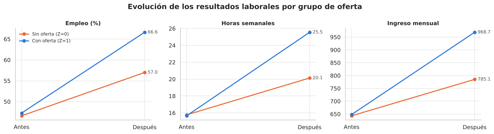

## El problema

Las responsabilidades de cuidado de hijos pequeños limitan la participación laboral de las madres, sobre todo cuando el horario del centro de cuidado no cubre la jornada laboral ni el traslado. Se amplió el horario de 5 centros de cuidado infantil y, como había más postulantes que vacantes, **las vacantes se asignaron por sorteo**.

## Por qué este diseño permite hablar de causalidad

El sorteo hace que las madres sorteadas y las no sorteadas sean, en promedio, iguales antes de la intervención. Lo verificamos: en las 10 características previas observadas (edad, educación, hijos, empleo previo, ingreso previo, red de cuidado, entre otras) las diferencias son mínimas. Por eso, la diferencia posterior entre ambos grupos se puede atribuir a la oferta del servicio.

Hubo una complicación: **no todas usaron lo asignado**. El 17 % de las sorteadas no usó el servicio y el 20 % de las no sorteadas lo usó igual. Por eso medimos dos efectos distintos:

| Efecto | Pregunta | Resultado en empleo |
|---|---|---|
| **De ofrecer** el servicio (ITT) | ¿Qué pasa si el Estado ofrece la vacante? | **+9.7 puntos porcentuales** |
| **De usarlo** (LATE) | ¿Qué le hace el servicio a quien lo usa gracias a la oferta? | **+15.5 puntos porcentuales** |

## Resultados

{fig-alt="Gráfico de líneas antes y después: empleo, horas e ingreso suben en ambos grupos, más en el grupo con oferta."}

- **Empleo:** de cada 100 madres a las que se ofrece la vacante, unas 10 más están trabajando en el seguimiento (de 57 % a 67 %).
- **Horas e ingreso:** +5.5 horas semanales y +189 unidades monetarias al mes. El aumento de ingreso es coherente con trabajar más horas, no con salarios más altos.
- **Bienestar:** +3.4 puntos (en una escala de 0 a 100). En promedio, la mayor carga de trabajo no reduce el bienestar.
- **Sin el grupo de control**, el efecto parecería el doble: el empleo de las no sorteadas también subió 10 puntos en el mismo período.

## Qué tan confiable es

Los resultados se mantienen con otros métodos de estimación, al excluir cualquier centro, al corregir por haber probado varios resultados y aun en el peor escenario posible para los datos faltantes de ingreso.

**Una revisión posterior a la exposición.** Los 5 centros pueden ser una muestra de los centros de la red municipal, y la pregunta de política es qué pasaría si se amplía el horario en otros centros. Por eso rehicimos la inferencia agrupando por centro, con un método diseñado para pocos grupos. El efecto estimado no cambia, pero el margen se ensancha: por cada 100 madres a las que se ofrece la vacante en otro centro, podrían emplearse **entre 3 y 16 más**. Sigue siendo un efecto claramente positivo; la lección es medir centro por centro al escalar. Detalle en el [notebook 06](notebooks/06_inferencia_conglomerados.ipynb).

## Qué no podemos afirmar

- **A quién focalizar:** no encontramos diferencias significativas entre subgrupos (madres solas, sin red de cuidado, con empleo previo), pero el estudio solo detectaría diferencias grandes.
- **El mecanismo fino:** sabemos que el servicio permite trabajar a más madres; no sabemos con precisión cuánto aumentan las horas de quienes ya trabajaban.
- **Costo-efectividad y largo plazo:** los datos no incluyen el costo por vacante ni el tiempo transcurrido hasta el seguimiento.

## Recomendación

La evidencia respalda **ampliar el horario de cuidado infantil** como política para aumentar el empleo de las madres postulantes. Si se extiende a otros centros, conviene hacerlo de forma escalonada y medir resultados en cada uno. El siguiente paso es estimar su **costo por madre adicional empleada** y medir efectos de más largo plazo.

[Ver el análisis completo →](notebooks/00_planteamiento_teoria_cambio.ipynb){.btn .btn-primary}
